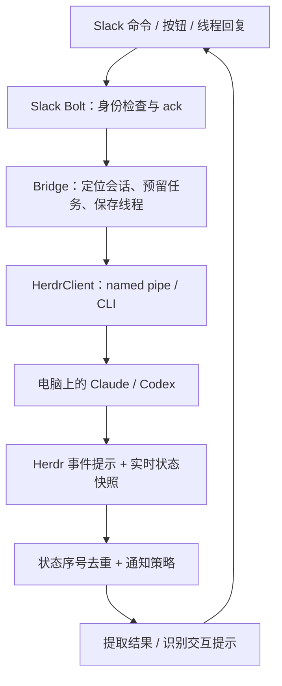

# herdr-slackbot 项目理解

这是 macOS 移植前的分析快照。随后实现的 macOS 支持见 [运行指南](../MACOS.md) 和 [验证记录](../progress/MACOS.md)；下述图谱与测试数字保留当时基线。

分析基线：`ad36ce3a`，2026-10-10。采用 [pstack Investigation](https://github.com/cursor/plugins/blob/main/pstack/skills/poteto-mode/playbooks/investigation.md) 与 [/how](https://github.com/cursor/plugins/blob/main/pstack/skills/how/SKILL.md) 指引，分三个角度追踪源码，再综合说明。原指引的模型名称在当前环境不可用，使用当前会话模型。Graphify 复用相邻 wasm-agent 的 0.9.82 安装，采用本地 AST 模式。业务代码未修改。

## 项目定位

这个项目是 Herdr 与 Slack 之间的远程控制桥。电脑负责运行 Claude/Codex，Slack 提供选目标、发任务、接收结果和回答交互提示的入口。核心工作是把 Slack 输入投递给正确的 agent，并把状态变化送回来。

生产目标是 Windows 10/11、Herdr 0.8.2+ 和 Python 3.11+。每位用户配置自己的 Slack app，Socket Mode 使用出站连接；Bolt 中间件只接纳绑定的 owner。当前 macOS 可以分析源码和运行大部分离线测试，不能证明 Windows 插件或真实 Slack 链路可用。

## 关键概念

- Pane 是屏幕位置，session 是会话身份。Slack 线程绑定 session，因此会话移动到其他 pane 后仍能继续对话。启动期间还没有 session 时，以 terminal 身份暂存并随后迁移。
- Task 是一次由 Slack 发起的任务，记录 task ID 和起始状态序号，用来识别任务完成。
- Dialog 是 agent 的交互提示。按钮携带 token，回答前重新检查 session、屏幕指纹和计划文件内容。
- Outcome unknown 表示请求可能已生效。代码会观察状态或查找 Slack 消息，避免盲目重发。

## 工作流程



发送分成两个步骤。先在 admission 锁内验证身份和可接收状态，创建或复用 owner 私信线程，并持久化任务；再在实际输入前重新验证 agent 身份。请求结果不明确时不会再次发送，只观察是否开始工作。见 [Bridge._admit](../../herdr_slackbot/bridge.py#L1344)、[_deliver](../../herdr_slackbot/bridge.py#L1408)。新 agent 还会先创建 tab、启动进程、确认身份与就绪状态。启动时出现信任弹窗，则保留首条 prompt 等回答后发送。

事件只是状态变化的线索。[SubscriptionManager](../../herdr_slackbot/events.py#L197) 获取实时快照，以 session 和递增状态序号去重，再交给单个通知队列处理。Slack 发起的任务即使 mute 也会回报完成或阻塞；电脑端任务主要在 active → done 时通知，active → idle 保持安静。Mute 也会抑制电脑端阻塞提醒。见 [通知策略](../../herdr_slackbot/notify.py#L74)。

弹窗解析是纯函数。Bridge 在按 terminal 分配的回答锁内重新验证按钮，生成按键或输入文本，并在操作后轮询确认。发生变化时重新渲染；无法确认时更换 token，防止排队的旧点击重复按键。锁顺序是回答锁 → admission 锁 → 线程锁。线程回复在弹窗打开时会尝试作为自由文本答案，否则按新 prompt 处理。见 [回答流程](../../herdr_slackbot/bridge.py#L1854)、[dialog.py](../../herdr_slackbot/dialog.py#L393)。

Claude 结果优先来自本地 JSONL 会话，屏幕解析是 fallback；Codex 目前使用终端尾部。Claude 完成消息还会收集上次成功通知以来的对话；history cursor 随已接受的 Slack 消息提交，没有可定位 cursor 时仅取最新一轮。见 [结果提取](../../herdr_slackbot/claude_session.py#L583)、[历史范围](../../herdr_slackbot/history.py#L86)、[结果提交](../../herdr_slackbot/bridge.py#L2291)。

## 代码位置与边界

| 关注点 | 入口与职责 |
|---|---|
| Slack 接入 | `slack_app.py`，owner guard、ack、命令/按钮/modal/message 回调 |
| 核心协调 | `bridge.py`，任务、线程、dialog、结果、Slack 投递重试与恢复 |
| Herdr 通信 | `herdr_client.py`，NDJSON named pipe、CLI fallback、事件流 |
| 事件协调 | `events.py`，每 pane 订阅、快照复核、去重、重连、会话移动 |
| 状态与策略 | `state.py`、`notify.py`，原子持久化、命名高水位、通知纯函数 |
| 文本处理 | `dialog.py`、`parser.py`、`claude_session.py`、`history.py` |
| Slack 展示与传输 | `blocks.py`、`slack_transport.py`，Block Kit 与 API 错误分类 |
| 插件生命周期 | `plugin.py`、`__main__.py`、`procinfo.py`，启动 reservation、实例锁、PID+创建时间、ready 标记 |
| 设置与绑定 | `wizard.py`、`setup_cmd.py`、`pairing.py`、`config.py` |

HerdrClient 仅在请求尚未发出，或只读请求结果未知时安全 fallback。修改请求结果未知则抛错，不直接重发。CLI 能处理单次请求，但事件订阅仍依赖 named pipe。StateStore 使用临时文件、fsync 和替换；线程内有 RLock，跨进程单实例依赖 bridge lock。Ready 标记在启动完成后写入，并校验进程身份和锁持有者，属于启动就绪证据，并非持续健康心跳。

## Graphify 产物与核对

- [交互关系图](graphify-out/graph.html)
- [源码与符号树](graphify-out/GRAPH_TREE.html)
- [完整图数据](graphify-out/graph.json)
- [自动结构报告](graphify-out/GRAPH_REPORT.md)
- [来源、文件 hash 与覆盖率](graphify-out/provenance.json)
- 查询记录：`graphify-out/query-*.txt`

扫描 60 个代码文件，得到 2,416 个节点、7,011 条原始关系。全部 26 个 Python 源文件有节点覆盖，另覆盖 31 个 tests 目录文件。原始关系包含 6,285 条 EXTRACTED 与 726 条 INFERRED。聚类按无向端点合并为 6,629 条边、98 个社区；自动报告的比例按合并后边统计，不能和原始关系数混用。

`Bridge` 是最高连接度节点，源文件约 2,466 行，源码也确认它集中了协调复杂度。图上的 `build_app ← imports — __main__ — imports → HerdrClient` 是最短导航路径，不是运行时调用链。动态对象方法、回调、锁和网络行为仍须读源码与测试。覆盖文件也不代表捕捉了全部符号或调用。

本轮 code-only 跳过文档和图片，不解析 fixture JSONL、plugin manifest 的语义；这些边界通过源码和文档人工核对。两份 HTML 已内置现有固定版本 JS，避免依赖 CDN。脚本替换、节点唯一性、边端点及查询已验证，浏览器实际渲染尚未验证。

## 验证与需要留意的行为

本轮实际执行 `.venv/bin/python -m pytest -q -p no:cacheprovider`，Python 3.12.15，pytest 9.1.1，slack-bolt 1.30.0，slack-sdk 3.45.0。结果为 **827 passed、6 skipped、4 failed**，共 837 项。

失败是 `test_strip_verbatim_and_shell_kind` 以及三个 readiness 用例：`test_marker_counts_only_for_the_live_lock_holder`、`test_run_in_owner_mode_marks_ready_and_clears_on_exit`、`test_run_in_pairing_mode_marks_ready_only_after_activation`。前者在 POSIX Path 上处理 Windows 反斜杠路径；后三项依赖进程创建时间，非 Windows 实现读取 `/proc`，macOS 不具备该接口，故 ready 验证返回 None。源码解释与失败一致，但不能据此声称 Windows 上全通过。Live 测试未启用，没有连接真实 Slack 或 Herdr。

以下是已确认的取舍或待验证问题，不是本轮修复清单：

- 延迟首条 prompt 在发送前从状态中清除，进程若在间隙退出可能丢失消息。这是源码明确记录的 at-most-once 取舍，见 [bridge.py](../../herdr_slackbot/bridge.py#L2065)。
- 会话/屏幕验证与 pane 按键发送是两个操作。Bridge 锁不能阻止用户同时在 PC 操作，未看到 Herdr 原子条件输入接口。
- Named pipe 普通请求的同步读取没有可见 deadline，初始 ping 等路径遇到静默服务可能长时间等待，未复现。
- 单个 notifier 线程会串行处理通知，某个回答或重试可能延迟其他 agent 的通知。并非持久消息队列，也不保证分布式 exactly-once。
- `events.py` 的旧订阅 reader 和 dispatcher 清理会访问共享 `_inflight`；若线程越过 stop 的 join timeout，在 restart 后存在污染新计数的可能。仅为源码候选问题，尚未复现。

历史 review 中的就绪判断、旧 tab 复用等问题已有源码修复。历史测试数字与发布状态也不是当前验证结果，不能直接照搬。

## 重建

用实际 Graphify 安装路径替换 `GRAPHIFY`，在项目根目录运行：

```sh
GRAPHIFY='/Volumes/My Shared Files/AI/wasm-agent/.tools/bin/graphify'
"$GRAPHIFY" extract . --code-only --max-workers 2 --out docs/project-graph --no-cluster
"$GRAPHIFY" cluster-only docs/project-graph --no-label
"$GRAPHIFY" tree --graph docs/project-graph/graphify-out/graph.json --root . --output docs/project-graph/graphify-out/GRAPH_TREE.html --label herdr-slackbot
.venv/bin/python docs/project-graph/finalize.py --graphify "$GRAPHIFY" --assets '/Volumes/My Shared Files/AI/wasm-agent/docs/tau-graph/graphify-out/assets'
```

`finalize.py` 保存源码 SHA-256、查询输出和边计数，并把已存在的 vis-network/D3 脚本内置到 HTML。重建依赖邻项目的工具和脚本资源，没有安装全局插件或 Git hooks。
